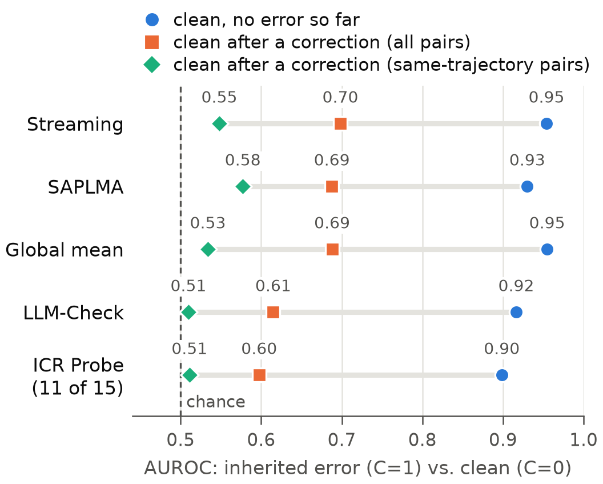

# Prefix detectors track whether an error occurred, not whether it is still active

## Motivation

The [notation document](../../theory/STEP_PREFIX_NOTATION.md) writes Prefix error probability as

```math
\pi^C_t=\pi^Y_t+(1-\pi^Y_t)\kappa_t,\qquad \kappa_t=P(C_t=1\mid Y_t=0, X_{\le t}).
```

The [composition analysis](../step_prefix_composition_20261111/README.md) shows that about 85% of Prefix positives are inherited (Y=0, C=1). Prefix detection is therefore mostly a matter of κ: when the current Step adds no new error, is an earlier error still active?

A detector can approximate this with a weaker cue: whether any error has occurred earlier in the trajectory. Both cues agree before the first error. They disagree only after an error has been corrected. We use those positions to test which cue a detector actually uses.



*Figure. AUROC of each detector's Prefix score on TEST. The positive class is always the same: positions with an inherited error (Y=0, C=1). Circle: against clean positions with no error so far in their trajectory. Square: against clean positions that follow a correction, over all pairs, most of which join different trajectories. Diamond: the same two classes, but pairing only positions of the same trajectory; the AUROC is computed inside each trajectory and averaged over trajectories. Each value is the mean over generator/domain combinations (15 per detector, 11 for ICR Probe). The dashed line marks chance.*

## Analysis settings

On TEST positions with Y=0, the positive class is **inherited** (C=1). Negatives are split by history:

| Negative | Definition | What separates it from inherited |
|---|---|---|
| fresh clean | C=0, no earlier C=1 in the trajectory | "an error occurred" suffices |
| recovered clean | C=0, some earlier C=1 in the trajectory | requires "the error is still active" |

- **AUROC_fresh:** inherited vs fresh clean.
- **AUROC_rec:** inherited vs recovered clean.
- **gap:** AUROC_fresh − AUROC_rec.

A detector that tracks κ itself has a small gap. A detector that tracks only "an error occurred" has a high AUROC_fresh and a low AUROC_rec.

Each AUROC is further split by where the two positions of a pair come from:

- **between:** the inherited and the clean position belong to different trajectories.
- **within:** both belong to the same trajectory. Within-trajectory fresh clean positions necessarily precede that trajectory's first error.
- **within, trajectory mean:** the AUROC is computed inside each trajectory that contains both classes, then averaged with equal weight per trajectory.

Each AUROC above is the pair-count-weighted mean of its between and within parts.

| Setting | Value |
|---|---|
| Dataset | Retained Streaming HD, 6:2:2; **TEST only** |
| Scope | Three generators, five domains |
| Scores | Each detector's TEST Prefix score saved by its original run, from the configuration frozen on VAL; no retraining, selection or inference |
| Detectors | Streaming, SAPLMA, global mean, LLM-Check, ICR Probe |
| Integrity checks | Saved position ids and labels equal the dataset loader's in order. Recomputed TEST Prefix AUROC equals the value recorded by the source run. |
| Uncertainty | 95% percentile intervals from 1,000 trajectory-bootstrap replicates |

Nothing is selected or tuned in this analysis, so it is reported on TEST like the detectors' main results. The earlier VAL version is kept in [`result/val/`](result/val/); its conclusions are the same (see the comparison at the end of the findings).

ICR Probe covers 11 of 15 combinations; its run has not finished for Math and Science of DS-L8 and Qwen3.8-27B. Those cells are listed as pending in `result/recovery.json`.

## Findings

### 1. Every detector separates inherited errors from fresh clean positions far better than from recovered ones

| Detector | Combinations | AUROC_rec | AUROC_fresh | gap (range) | gap CI above 0 |
|---|---:|---:|---:|---:|---:|
| Streaming | 15 | 0.698 | 0.954 | 0.256 (0.035–0.427) | 14 |
| SAPLMA | 15 | 0.688 | 0.930 | 0.242 (0.026–0.370) | 14 |
| Global mean | 15 | 0.688 | 0.955 | 0.267 (0.055–0.515) | 14 |
| LLM-Check | 15 | 0.615 | 0.916 | 0.301 (0.146–0.418) | 15 |
| ICR Probe | 11 | 0.597 | 0.898 | 0.301 (0.045–0.419) | 10 |

Values are means over combinations.

- Over all 71 detector–combination pairs, AUROC_fresh averages 0.933 and AUROC_rec averages 0.661.
- The gap's 95% interval excludes zero in 67 pairs. The four exceptions are all DS-L8 Factuality, which has only 24 recovered positions in 15 trajectories.
- Learned probes, a training-free score and a dedicated streaming detector show the same pattern.

### 2. The deficit is shared across generators and domains

| Generator | Mean AUROC_rec | Mean gap |
|---|---:|---:|
| DS-L8 | 0.725 | 0.191 |
| Gemma-4-31B-it | 0.576 | 0.351 |
| Qwen3.8-27B | 0.689 | 0.267 |

| Domain | Mean AUROC_rec | Mean gap |
|---|---:|---:|
| Math | 0.698 | 0.273 |
| Science | 0.713 | 0.251 |
| Logic | 0.639 | 0.307 |
| Multi-hop | 0.635 | 0.291 |
| Factuality | 0.631 | 0.236 |

### 3. Within a trajectory, detectors mark the first error but not later corrections

Errors and corrections alternate within trajectories: 94.9% of TEST inherited positions are preceded by at least one correction (Prefix 1→0) in their own trajectory. Whether an error is still active is therefore mainly a within-trajectory question.

Within-trajectory pairs, however, are only 2.1% of inherited–recovered pairs on average (at most 11.5%), so AUROC_rec above mostly measures between-trajectory pairs.

| Detector | fresh between | fresh within | fresh within, traj. mean | rec between | rec within | rec within, traj. mean |
|---|---:|---:|---:|---:|---:|---:|
| Streaming | 0.954 | 0.968 | 0.959 | 0.697 | 0.629 | 0.548 |
| SAPLMA | 0.930 | 0.933 | 0.892 | 0.688 | 0.608 | 0.577 |
| Global mean | 0.955 | 0.978 | 0.971 | 0.690 | 0.589 | 0.534 |
| LLM-Check | 0.916 | 0.950 | 0.978 | 0.613 | 0.588 | 0.510 |
| ICR Probe | 0.899 | 0.894 | 0.912 | 0.595 | 0.549 | 0.511 |

Values are means over combinations (15 per detector, 11 for ICR Probe).

- Inside a trajectory, positions before the first error are separated from later inherited positions: within-trajectory fresh AUROC averages 0.947.
- After the first error, active and corrected positions of the same trajectory are barely separated:
  - within-trajectory recovered AUROC averages 0.595 (range 0.232–0.863);
  - its trajectory mean averages 0.537, close to chance.
- Within-trajectory recovered AUROC is below its between-trajectory value in 56 of 71 detector–combination pairs. The ≈ 0.66 of AUROC_rec therefore comes mainly from differences between trajectories.

### 4. TEST and VAL agree

Means over the same 71 detector–combination pairs on both splits.

| Statistic | VAL | TEST |
|---|---:|---:|
| AUROC_fresh | 0.958 | 0.933 |
| AUROC_rec | 0.732 | 0.661 |
| gap | 0.226 | 0.272 |
| gap CI above 0 | 69 / 71 | 67 / 71 |
| rec within | 0.628 | 0.595 |
| rec within, traj. mean | 0.534 | 0.537 |

The pattern is the same and slightly stronger on TEST. The VAL files in `result/val/` were computed when ICR Probe covered 7 combinations; the VAL column here uses its 11 current combinations.

## Interpretation

Existing Prefix detectors behave like detectors of "an error has occurred in the trajectory". They do not behave like estimators of κ, the probability that an earlier error is still active. Within a trajectory, their scores rise at the first error but do not follow later corrections and renewed errors. What remains across trajectories reflects differences in their overall level.

This suggests focusing on how to model κ better, so that corrected errors can be distinguished from errors that are still active. The within-trajectory recovered AUROC, especially its trajectory mean, measures this distinction more directly than AUROC_rec, which between-trajectory differences inflate.

## Limitations

- Recovered clean positions come from a limited number of TEST trajectories per combination: 15–201, and 155 for Qwen Logic. Intervals are wide where this number is small.
- Fresh clean positions lie mostly early in trajectories, so AUROC_fresh may also reflect position. Within a trajectory, "after the first error" and "later in the trajectory" cannot be separated by this analysis. This does not affect the low AUROC_rec.
- A near-chance within-trajectory AUROC may partly reflect how consistently Prefix labels are assigned over time within a trajectory. The present data cannot separate this from detector behaviour.

## Artifacts

- [Configuration](config.json): definitions, scope and integrity checks.
- [Recovery JSON](result/recovery.json): unrounded statistics, confidence intervals, position counts, pending cells and source-file hashes.
- [Recovery CSV](result/recovery.csv): one row per detector, generator and domain.
- [Within-trajectory JSON](result/within.json) and [CSV](result/within.csv): between, within and trajectory-mean AUROC for both negative types, with within-trajectory confidence intervals and pair counts.
- [VAL version](result/val/): the same four files from the earlier VAL analysis.
- Figure: [PDF](result/figure.pdf), [PNG](result/figure.png).

Only aggregate statistics and input-file identities are published. Labels, splits, predictions and detector weights are unchanged and not included.
