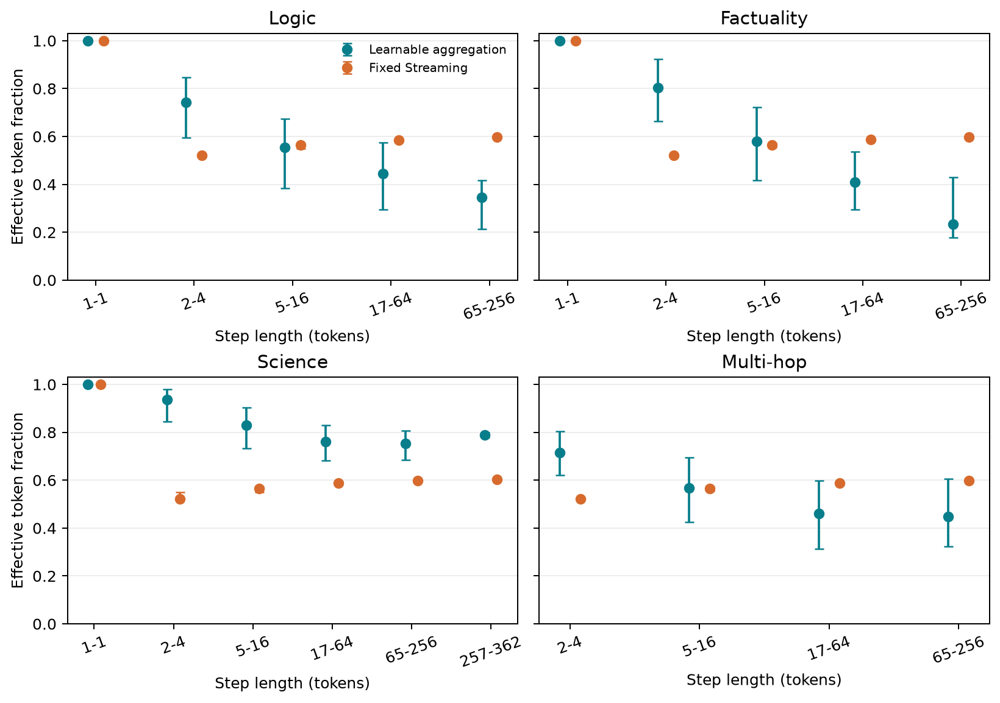
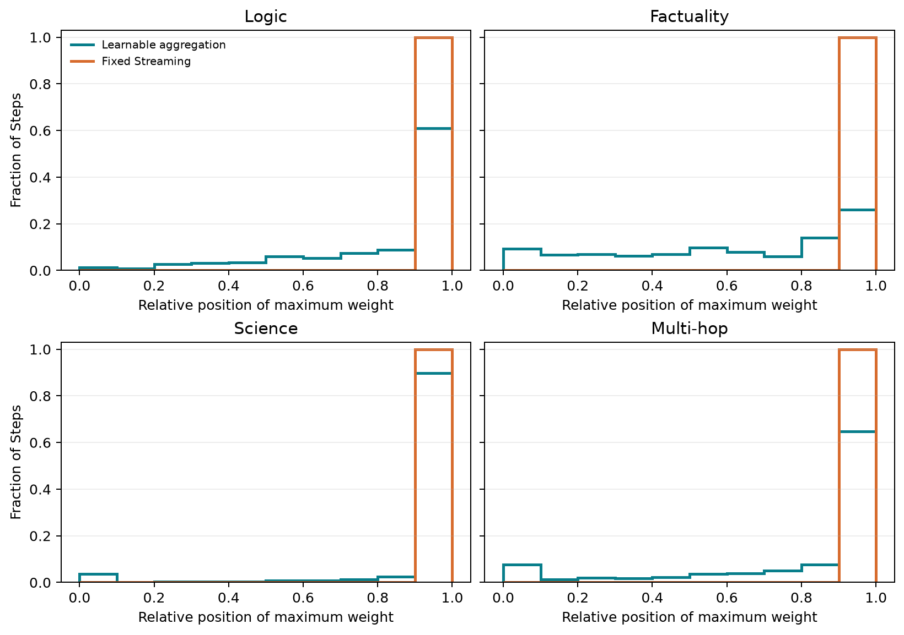

# Qwen Step-only aggregation concentration

Measure how the frozen legacy learnable aggregation distributes mass within a Step relative to Streaming positional pooling on identical token spans.

| Configuration | Logic | Factuality | Science | Multi-hop |
| --- | --- | --- | --- | --- |
| Legacy learnable aggregation | Layer 35, epoch 3 | Layer 49, epoch 1 | Layer 46, epoch 2 | Layer 40, epoch 3 |
| Streaming fixed aggregation | Same Step spans | Same Step spans | Same Step spans | Same Step spans |

| Setting | Value |
| --- | --- |
| Fit and selection | Published VAL-selected checkpoints, frozen |
| Evaluation | One CPU scorer pass on VAL; fixed comparator uses softmax of 3u |
| Metrics | Effective token fraction, Top-1 and Top-3 mass, final 20% mass, relative argmax position |
| Aggregation | Per-domain quartiles and paired differences, overall and stratified by Step length |

Single-token Steps contribute to concentration summaries. Relative argmax position is defined for Steps with at least two tokens.

## Median VAL effective token fraction

| Configuration | Logic | Factuality | Science | Multi-hop |
| --- | --- | --- | --- | --- |
| Legacy learnable aggregation | 0.5268 | 0.5278 | 0.8007 | 0.5296 |
| Streaming fixed aggregation | 0.5700 | 0.5724 | 0.5763 | 0.5763 |

All four domains are complete. Markers show medians and bars span the interquartile range.

The maximum-weight position is normalized from the first token (0) to the last token (1).

