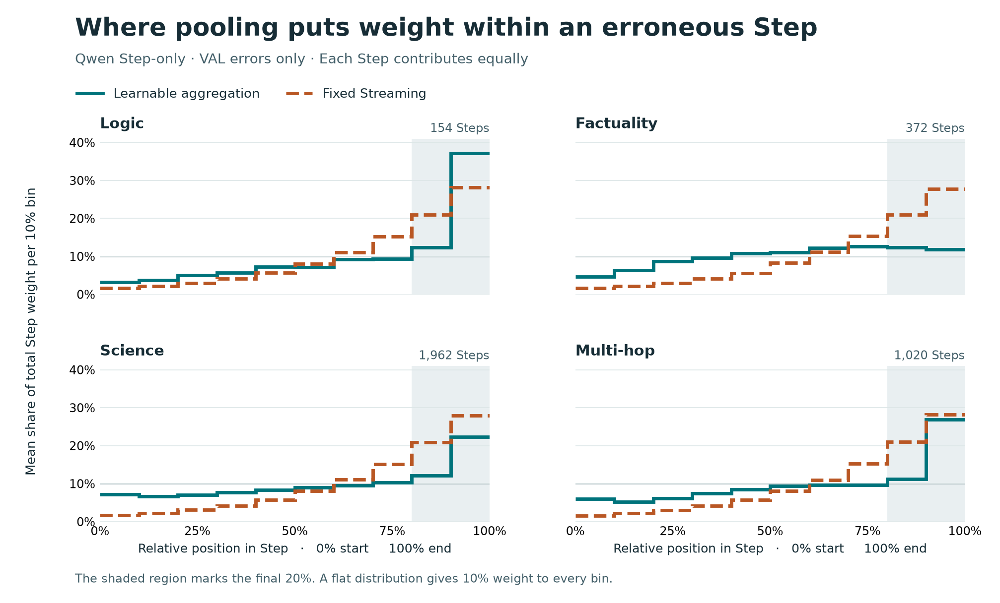
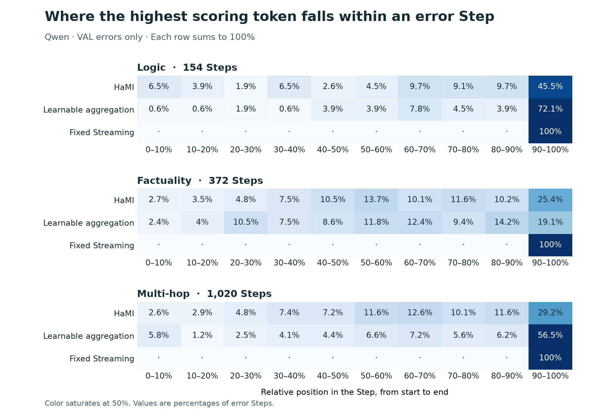
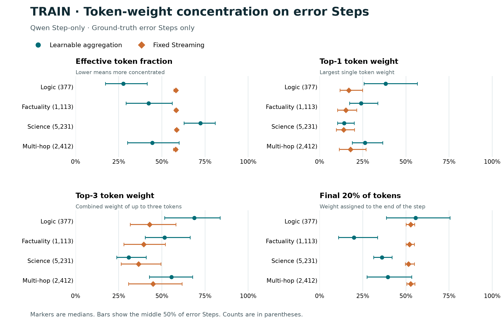
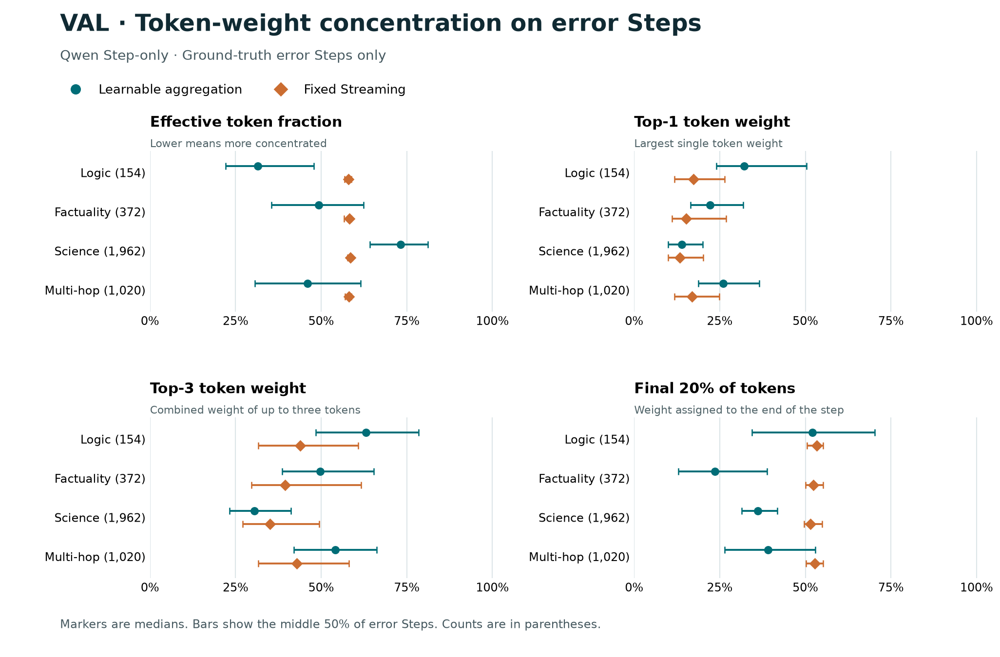

# Qwen pooling weights within erroneous Steps

This VAL diagnostic includes only Steps with the ground-truth Step error label equal to 1. It compares the frozen legacy learnable aggregation checkpoint in each domain with fixed Streaming on the same Steps. The learned scorer reads the existing selected-layer token features.

From Step start (0%) to Step end (100%), each plotted bin shows the mean share of the Step's pooling weight in that positional decile. Each token spans an equal part of its Step. Its weight is split proportionally when it overlaps more than one bin. The ten bin shares sum to 100%, and each Step contributes equally. The shaded region marks the final 20%.

[Per-domain values and coverage](result/index.json)

## Highest scoring token

Each row shows where the highest scoring HaMI token or highest weight pooling token falls across the same VAL error Steps. Positions run from the first token (0%) to the last (100%). A single token is placed at 50%. Tied maxima share that Step's count equally.

HaMI uses its own frozen VAL-selected layer and its original token scorer. Its Step prediction averages the top floor(0.1 × token count) + 1 token scores. The heatmap tracks the location of the highest scoring token. Reconstructed HaMI Step scores agree with the saved VAL scores on this cohort to within 2 × 10⁻⁷. The three-way comparison covers Logic, Factuality and Multi-hop. Qwen Science HaMI is awaiting layer selection.

[Per-domain highest-token distributions and provenance](result/highest_token.json)

## Concentration on error Steps in TRAIN and VAL

The two figures use the same frozen, VAL-selected learnable-aggregation checkpoint per domain. Both methods use the same ground-truth error Steps within each split. Markers show the median and bars show the first to third quartile across Steps. TRAIN describes the fitted model on its training data.

The effective token fraction is 1 divided by the product of the token count and the sum of squared pooling weights. Top-1 and Top-3 sum the largest one and up to three weights. The final-20% measure sums the weights of the last ceiling(token count / 5) tokens.

[Per-domain TRAIN and VAL statistics](result/error_concentration_train_val.json)
