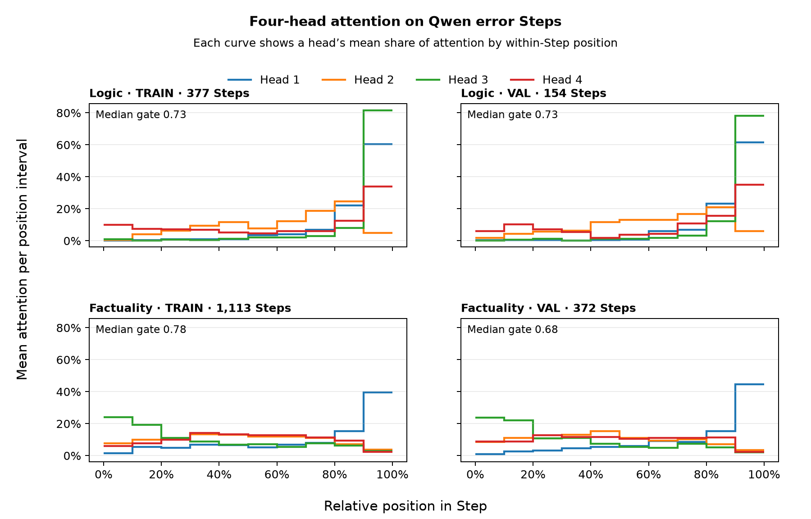

# Four-head Step attention with a gated residual

The Step token mean is projected to 128 dimensions and supplies the queries for four 32-dimensional attention heads. The token states supply keys and values. Each head normalizes over the effective tokens in the current Step. The four attended outputs are concatenated. A 128-unit tanh MLP emits a scalar sigmoid gate for the attention residual. Dropout is 0.3 in the gate, residual and linear Step readout. Layer normalization follows the residual dropout.

Use the pre-dataset legacy recipe on Qwen Logic and Factuality. The frozen token features, Step labels, randomized batches of 128 Steps, seed 42, Adam learning rate 0.001, weight decay 0.0005, 20-epoch cap, patience 5, epoch and VAL layer selection, and single frozen TEST follow the original learnable aggregation run. The two Pods own layers 1–32 and 33–64 of both domains, with Logic first. Reuse the original learnable aggregation comparison.

## Attention on error Steps

The frozen selected detector is evaluated on ground-truth error Steps in TRAIN and VAL. Each curve sums to 100% across ten relative positions. Median gate values appear in the panels. [Per-head data and gate quantiles](diagnostics.json).
