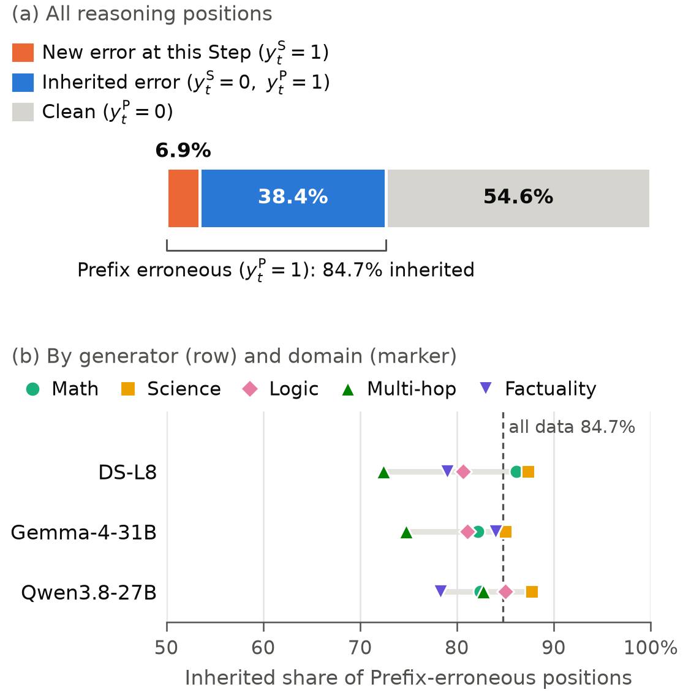

# Prefix errors are mostly inherited, not new

## Motivation

The manual constraint Step=1 ⇒ Prefix=1 splits every reasoning position into three mutually exclusive outcomes:

| Outcome | Labels | Meaning |
|---|---|---|
| new | $`y^{\mathrm{S}}_t=1`$ | the Step introduces a new error |
| inherited | $`y^{\mathrm{S}}_t=0,\ y^{\mathrm{P}}_t=1`$ | no new error, but an earlier error is still unresolved |
| clean | $`y^{\mathrm{P}}_t=0`$ | no unresolved error |

Prefix error probability is therefore Step error probability plus the inherited term, $`\pi^{\mathrm{P}}_t=\pi^{\mathrm{S}}_t+\psi_t`$. We measure how large each outcome is. These are label counts; they do not measure how detectable each outcome is from internal signals.

*Figure. (a) Share of all 1,445,280 reasoning positions that introduce a new error ($`y^{\mathrm{S}}_t=1`$), carry an inherited error ($`y^{\mathrm{S}}_t=0,\ y^{\mathrm{P}}_t=1`$) or are clean ($`y^{\mathrm{P}}_t=0`$). The bracket marks Prefix-erroneous positions, of which 84.7% are inherited. (b) Inherited share of Prefix-erroneous positions for each of the 15 generator/domain combinations: one row per generator, one marker per domain. The dashed line is the share over all data.*

## Analysis settings

| Setting | Value |
|---|---|
| Dataset | Retained Streaming HD, 6:2:2, TEST target p >= 70%, with frozen per-combination relaxations |
| Scope | Three generators, five domains; **TRAIN + VAL + TEST** |
| Unit | One retained Step position |
| Labels | Step $`y^{\mathrm{S}}_t`$ and Prefix $`y^{\mathrm{P}}_t`$ as annotated; no label is derived or changed |
| Computation | Exact label counts; no detector training or model inference |
| Integrity checks | Binary labels, matched Step/Prefix lengths, zero positions with $`y^{\mathrm{S}}_t=1`$ and $`y^{\mathrm{P}}_t=0`$, unique sample IDs, source SHA256 against split manifests, all 15,697 trajectories |

The statistics describe the dataset and involve no model, so all splits are counted. An earlier version of this analysis used TRAIN + VAL only; the per-split table below shows that the result is the same in every split.

## Overall results

Over 1,445,280 positions in 15,697 trajectories:

- **new:** 6.92%
- **inherited:** 38.44%
- **clean:** 54.64%

Among Prefix-positive positions, **84.74%** are inherited. Every generator/domain combination lies between 72.43% and 87.76%.

| Domain | Inherited share of Prefix positives |
|---|---:|
| Math | 84.15% |
| Science | 87.32% |
| Logic | 81.65% |
| Multi-hop | 79.61% |
| Factuality | 79.99% |

| Generator | Inherited share of Prefix positives |
|---|---:|
| DS-L8 | 85.85% |
| Gemma-4-31B-it | 82.66% |
| Qwen3.8-27B | 83.87% |

## Results by split

The range is over the 15 generator/domain combinations of the split.

| Split | Trajectories | Positions | new | inherited | clean | Inherited share of Prefix positives | Range |
|---|---:|---:|---:|---:|---:|---:|---:|
| TRAIN | 9,418 | 784,422 | 6.96% | 38.24% | 54.80% | 84.60% | 71.24–87.49% |
| VAL | 3,142 | 280,665 | 6.85% | 38.78% | 54.37% | 85.00% | 68.91–88.20% |
| TEST | 3,137 | 380,193 | 6.90% | 38.60% | 54.51% | 84.84% | 72.25–88.02% |
| All | 15,697 | 1,445,280 | 6.92% | 38.44% | 54.64% | 84.74% | 72.43–87.76% |

## Results by generator and domain

Percentages of new, inherited and clean use all retained positions in the group; the last column uses Prefix-positive positions.

| Generator | Domain | Trajectories | Positions | new | inherited | clean | Inherited share of Prefix positives |
|---|---|---:|---:|---:|---:|---:|---:|
| DS-L8 | Math | 1,028 | 238,991 | 9.58% | 59.48% | 30.94% | 86.13% |
| DS-L8 | Science | 1,059 | 168,576 | 9.58% | 66.25% | 24.17% | 87.36% |
| DS-L8 | Logic | 1,000 | 47,255 | 6.69% | 27.82% | 65.50% | 80.62% |
| DS-L8 | Multi-hop | 1,148 | 18,478 | 13.71% | 36.02% | 50.28% | 72.43% |
| DS-L8 | Factuality | 1,000 | 6,697 | 14.78% | 55.56% | 29.66% | 78.99% |
| Gemma-4-31B-it | Math | 1,000 | 58,811 | 8.27% | 38.15% | 53.58% | 82.19% |
| Gemma-4-31B-it | Science | 1,047 | 53,235 | 4.85% | 27.53% | 67.62% | 85.01% |
| Gemma-4-31B-it | Logic | 1,000 | 32,937 | 2.04% | 8.73% | 89.23% | 81.08% |
| Gemma-4-31B-it | Multi-hop | 1,153 | 10,268 | 9.03% | 26.70% | 64.27% | 74.73% |
| Gemma-4-31B-it | Factuality | 1,000 | 16,947 | 4.73% | 24.85% | 70.42% | 84.02% |
| Qwen3.8-27B | Math | 1,000 | 481,907 | 5.69% | 26.65% | 67.66% | 82.40% |
| Qwen3.8-27B | Science | 1,088 | 189,756 | 5.05% | 36.23% | 58.72% | 87.76% |
| Qwen3.8-27B | Logic | 1,000 | 49,831 | 1.69% | 9.57% | 88.74% | 85.01% |
| Qwen3.8-27B | Multi-hop | 1,159 | 51,395 | 8.93% | 42.86% | 48.21% | 82.76% |
| Qwen3.8-27B | Factuality | 1,015 | 20,196 | 9.97% | 36.05% | 53.98% | 78.33% |

## How often the erroneous state closes

A correction is a Prefix 1→0 transition. A recovered clean position has $`y^{\mathrm{P}}_t=0`$ after an earlier $`y^{\mathrm{P}}_t=1`$ in its trajectory.

| Split | Trajectories with an error | of which contain a correction | Recovered share of clean positions | Inherited positions preceded by a correction |
|---|---:|---:|---:|---:|
| TRAIN | 5,873 | 76.59% | 67.69% | 89.78% |
| VAL | 1,943 | 75.60% | 69.85% | 90.35% |
| TEST | 2,529 | 90.23% | 77.23% | 94.91% |
| All | 10,345 | 79.74% | 70.61% | 91.25% |

Corrections are common: four in five erroneous trajectories contain one, and most clean positions are recovered positions.

## Interpretation

Prefix detection is dominated by deciding whether an earlier error is still unresolved, not by detecting a new error at the current Step. The share is stable across splits, generators and domains although total error rates differ widely. It partly reflects how long errors persist under the Prefix definition: an error that is never retracted labels every later position as inherited. Position-weighted totals are dominated by long trajectories; compare combinations with the per-combination table.

## Artifacts

- [Configuration](config.json): counting definitions and scope.
- [Composition JSON](result/composition.json): unrounded counts and percentages for TRAIN, VAL, TEST, TRAIN + VAL and all data, plus portable source hashes.
- [Composition CSV](result/composition.csv): the same rows in tabular form.
- Figure: [PDF](result/figure.pdf), [PNG](result/figure.png).

Only aggregate statistics and input-file identities are published. Original labels, split assignments and raw trajectories are unchanged.
