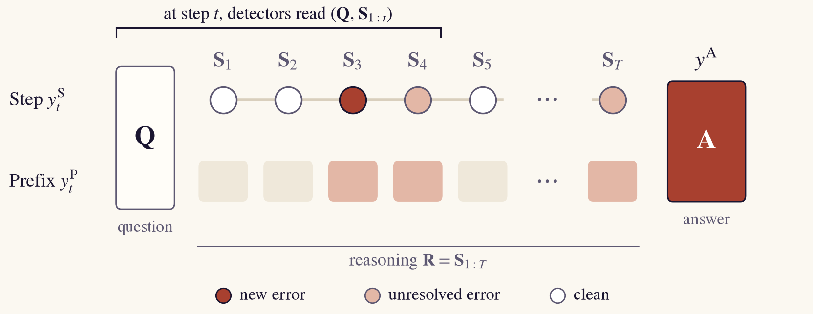
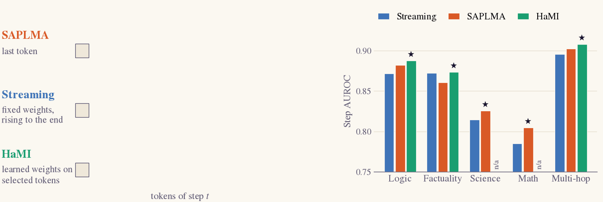
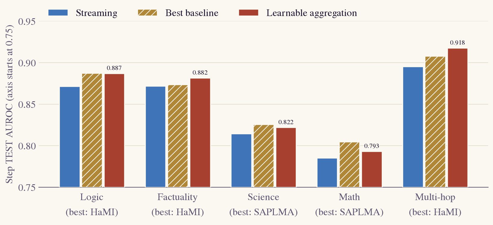
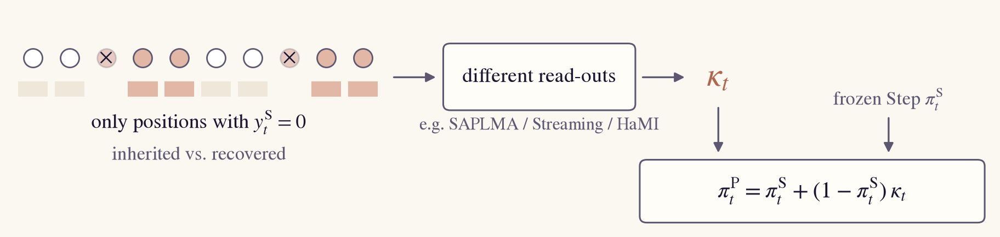

# Errors Are Introduced, Then Carried

*Streaming hallucination detection as one chain from Step to Prefix to Answer.*

<!-- kicker: The **task** -->
## §1 Three levels of one trajectory



While the model reasons, each detector reads what has been generated so far and outputs the probability that its label is 1:

```math
\begin{aligned}
\pi^{\mathrm{S}}_t&=\mathbb{P}_{D^{\mathrm{S}}}(y^{\mathrm{S}}_t=1\mid \mathbf{Q},\mathbf{S}_{1:t}), &&\text{Step}\\
\pi^{\mathrm{P}}_t&=\mathbb{P}_{D^{\mathrm{P}}}(y^{\mathrm{P}}_t=1\mid \mathbf{Q},\mathbf{S}_{1:t}), &&\text{Prefix}\\
\pi^{\mathrm{A}}&=\mathbb{P}_{D^{\mathrm{A}}}(y^{\mathrm{A}}=1\mid \mathbf{Q},\mathbf{R},\mathbf{A}). &&\text{Answer}
\end{aligned}
```

<!-- kicker: The **decomposition** -->
## §2 Probability decomposition from first principles


The Answer builds on the final Prefix state, with $`\alpha_c`$ the probability of a wrong answer given final Prefix label $`c`$:

```math
\pi^{\mathrm{A}}=\pi^{\mathrm{P}}_T\,\alpha_1+(1-\pi^{\mathrm{P}}_T)\,\alpha_0 .
```

<!-- kicker: The **difficulty** -->
## §3 Challenges

### Step: no single read-out is best



**Finding.** HaMI is best on Logic, Factuality and Multi-hop; SAPLMA on Science and Math.

**Motivation.** Can one read-out combine their strengths? A better Step read-out is also the base of the Prefix.

### Prefix: the hard part is κ


**Finding.** 85% of Prefix errors are inherited. Existing detectors separate them from positions before any error (0.93) far better than from positions whose earlier error was resolved (0.66).

**Motivation.** The difficulty of Prefix detection lies in $`\kappa_t`$.

### Summary

- **Step**: design of the read-out (important).
- **Prefix**: design of $`\kappa_t`$ (core).
- **Answer**: built on the Prefix (tentative, not the focus).

The three levels form one chain through the decomposition.

<!-- kicker: The **numbers** -->
## §4 Preliminary results

### Step

**Motivation.** Learn which tokens of a step to read, rather than fixing them in advance.

**Method.** Learnable aggregation: a learned score per token, a softmax over the step, and a linear head on the weighted sum of token states.

**Result.**



### Prefix

**Motivation.** Model $`\kappa_t`$ directly.

**Method.** Try different read-outs for $`\kappa_t`$, e.g. SAPLMA / Streaming / HaMI, only where the step adds no new error, and test whether they separate inherited errors from recovered ones.



**Result.**

<!-- kicker: The **plan** -->
## §5 Next
