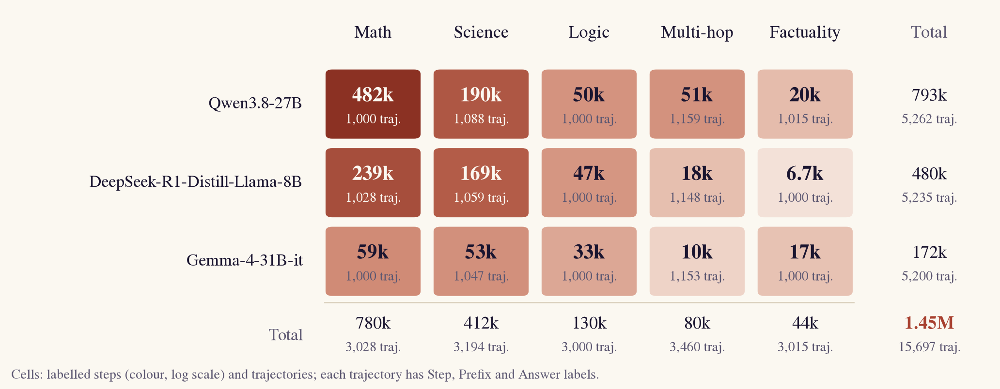
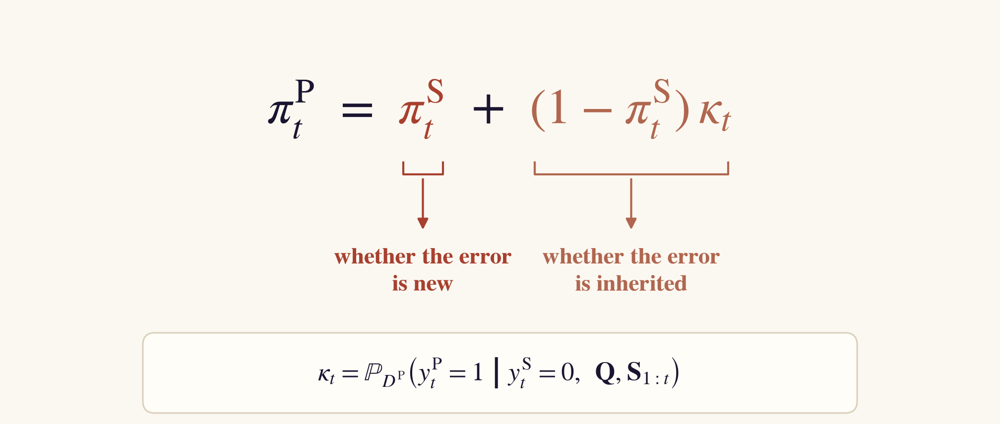
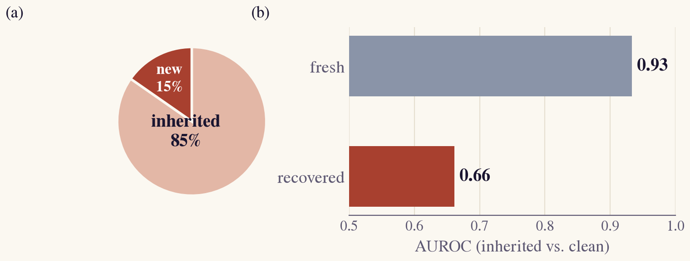
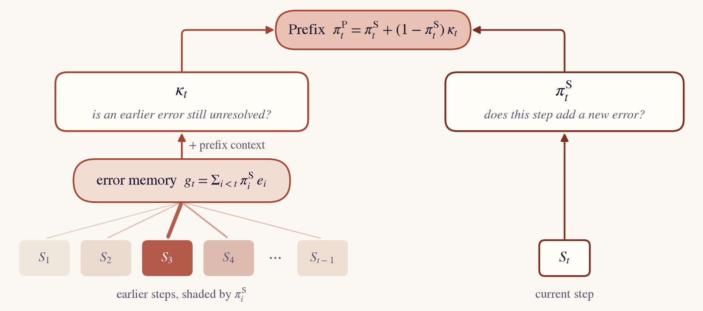
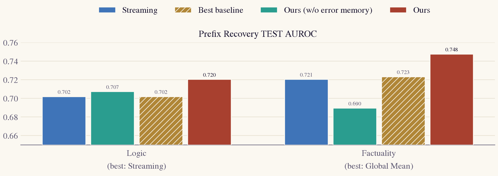

# Errors Are Introduced, Then Carried

*Streaming hallucination detection as one chain from Step to Prefix to Answer.*

<!-- kicker: The **task** -->
## §1 Background


While the model reasons, each detector reads what has been generated so far and outputs the probability that its label is 1:

```math
\begin{aligned}
\pi^{\mathrm{S}}_t&=\mathbb{P}_{D^{\mathrm{S}}}(y^{\mathrm{S}}_t=1\mid \mathbf{Q},\mathbf{S}_{1:t}), &&\text{Step}\\
\pi^{\mathrm{P}}_t&=\mathbb{P}_{D^{\mathrm{P}}}(y^{\mathrm{P}}_t=1\mid \mathbf{Q},\mathbf{S}_{1:t}), &&\text{Prefix}\\
\pi^{\mathrm{A}}&=\mathbb{P}_{D^{\mathrm{A}}}(y^{\mathrm{A}}=1\mid \mathbf{Q},\mathbf{R},\mathbf{A}). &&\text{Answer}
\end{aligned}
```



<!-- kicker: The **decomposition** -->
## §2 Theory



The Answer builds on the final Prefix state, with $`\alpha_c`$ the probability of a wrong answer given final Prefix label $`c`$:

```math
\pi^{\mathrm{A}}=\pi^{\mathrm{P}}_T\,\alpha_1+(1-\pi^{\mathrm{P}}_T)\,\alpha_0 .
```

<!-- kicker: The **difficulty** -->
## §3 Challenge



**Diagnosis.** 85% of Prefix errors are inherited. Existing detectors separate them from positions before any error (0.93) far better than from positions whose earlier error was resolved (0.66).

**Challenge.** Prefix detection hinges on $`\kappa_t`$: distinguishing an inherited error that remains unresolved from one that has already been corrected, a distinction existing detectors barely capture.

<!-- kicker: The **framework** -->
## §4 Method



↳ Method details: [error-memory experiment](https://github.com/pILLOW-1/streaming_hd/blob/main/experiments/qwen_c18_error_memory_20261114/README.md).

<!-- kicker: The **numbers** -->
## §5 Preliminary result

Experiments are run on Qwen3.8-27B, in the Logic and Factuality domains.




**Finding.** The error memory helps recovery: it raises the inherited-vs-recovered AUROC from 0.707 to 0.720 on Logic and from 0.690 to 0.748 on Factuality, above every baseline.

**Limitation.** Under joint modelling, Step performance still trails the best baseline (0.877 vs 0.887 on Logic), and the framework has so far been run on only two domains.

<!-- kicker: The **plan** -->
## §6 To do

- Building on the current framework, explore:

    1. different read-outs for the Step and Prefix inputs (e.g. last token);
    2. κ designs, including how κ is supervised and what the error memory stores;
    3. Ana's GRU memory design, in collaboration with her.

- Run the current framework on the other domains (Science, Math, Multi-hop).
