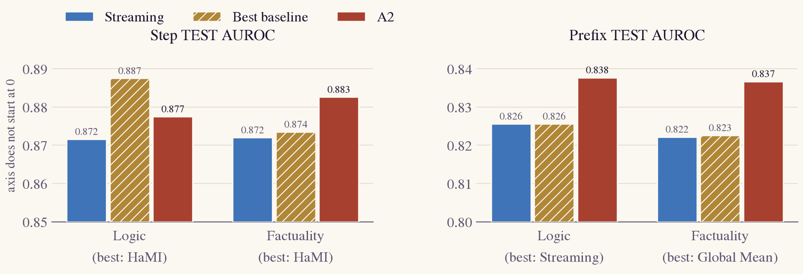

# Errors Are Introduced, Then Carried

*Streaming hallucination detection as one chain from Step to Prefix to Answer.*

<!-- kicker: The **task** -->
## §1 Three levels of one trajectory


While the model reasons, each detector reads what has been generated so far and outputs the probability that its label is 1:

```math
\begin{aligned}
\pi^{\mathrm{S}}_t&=\mathbb{P}_{D^{\mathrm{S}}}(y^{\mathrm{S}}_t=1\mid \mathbf{Q},\mathbf{S}_{1:t}), &&\text{Step}\\
\pi^{\mathrm{P}}_t&=\mathbb{P}_{D^{\mathrm{P}}}(y^{\mathrm{P}}_t=1\mid \mathbf{Q},\mathbf{S}_{1:t}), &&\text{Prefix}\\
\pi^{\mathrm{A}}&=\mathbb{P}_{D^{\mathrm{A}}}(y^{\mathrm{A}}=1\mid \mathbf{Q},\mathbf{R},\mathbf{A}). &&\text{Answer}
\end{aligned}
```

<!-- kicker: The **decomposition** -->
## §2 Probability decomposition from first principles


The Answer builds on the final Prefix state, with $`\alpha_c`$ the probability of a wrong answer given final Prefix label $`c`$:

```math
\pi^{\mathrm{A}}=\pi^{\mathrm{P}}_T\,\alpha_1+(1-\pi^{\mathrm{P}}_T)\,\alpha_0 .
```

<!-- kicker: The **difficulty** -->
## §3 Challenge: the hard part is κ


**Finding.** 85% of Prefix errors are inherited. Existing detectors separate them from positions before any error (0.93) far better than from positions whose earlier error was resolved (0.66).

**Motivation.** The difficulty of Prefix detection lies in $`\kappa_t`$: deciding whether an earlier error is still unresolved.

<!-- kicker: The **framework** -->
## §4 Method: A2, an error memory for κ


**Idea.** To judge whether an earlier error is still unresolved, $`\kappa_t`$ should know which earlier steps were likely wrong and what they said. A2 keeps that as a memory of earlier step features, each weighted by its predicted Step probability:

```math
g_t=\sum_{i<t} q_i\,e_i,\qquad
\kappa_t=\sigma\!\left(b+\theta^\top c_t+w^\top g_t\right),\qquad
\pi^{\mathrm{P}}_t=q_t+(1-q_t)\,\kappa_t .
```

Step and conditional heads are linear and trained jointly with one three-class loss over new error, inherited error and clean; the weights $`q_i`$ in the memory are not back-propagated. A2 is the backbone for the next explorations: how $`q`$ is obtained (frozen or trained), how $`\kappa`$ is supervised, and what the memory stores.

<!-- kicker: The **numbers** -->
## §5 Results



<!-- kicker: The **plan** -->
## §6 Next
