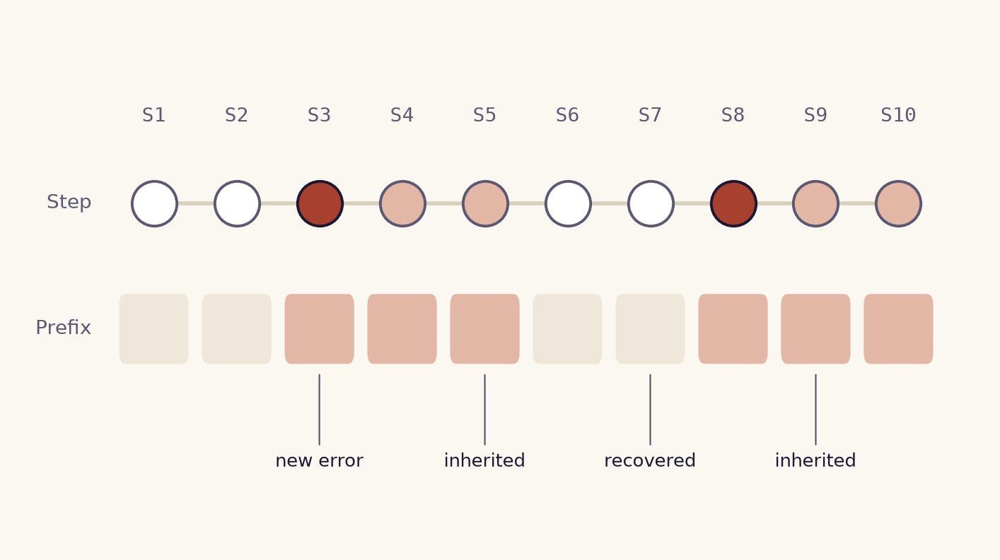
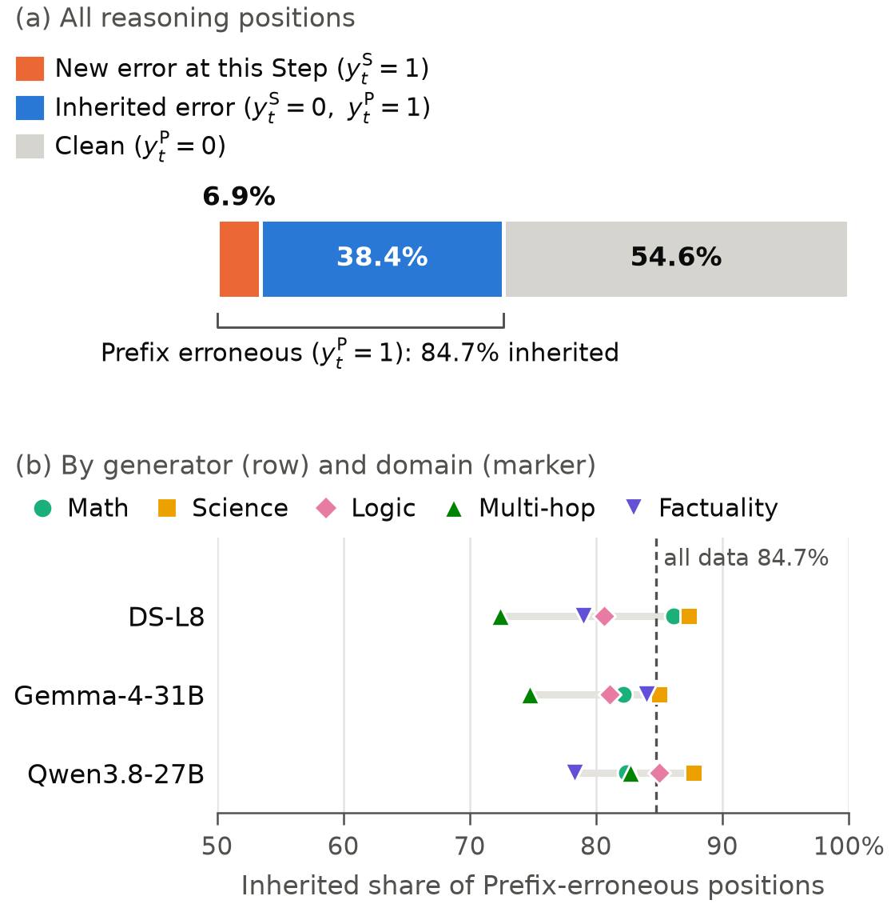
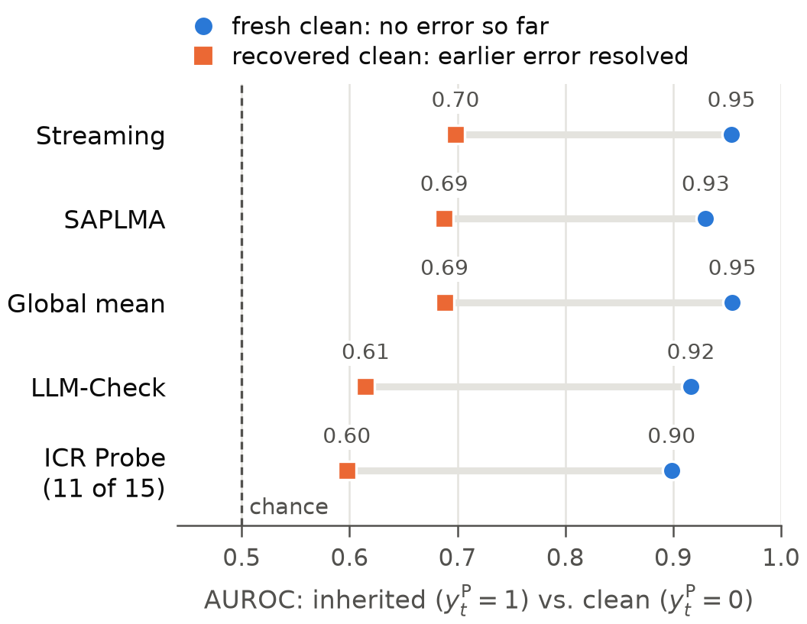

# Errors Are Introduced, Then Carried

*Splitting streaming hallucination detection into a Step event and an unresolved-error state.*



<!-- kicker: The **setting** -->
## §1 Background

A reasoning model writes its solution one step at a time. A streaming detector reads only the problem and the steps generated so far, together with the model's internal states, and has to flag errors as they happen rather than after the answer is out.

Every reasoning step carries three labels:

- **Step** $`y^{\mathrm{S}}_t`$: this step introduces a new committed error.
- **Prefix** $`y^{\mathrm{P}}_t`$: the reasoning so far contains at least one unresolved error. An error stays unresolved while the reasoning still endorses it or depends on it.
- **Answer** $`y^{\mathrm{A}}`$: the final answer is wrong.

The annotation protocol imposes one constraint: a new error makes the Prefix erroneous, $`y^{\mathrm{S}}_t=1\Rightarrow y^{\mathrm{P}}_t=1`$.

The data cover three generators (DS-L8, Gemma-4-31B-it, Qwen3.8-27B) and five domains (Math, Science, Logic, Multi-hop, Factuality): 15,697 trajectories and 1.45 million labelled steps.

<!-- kicker: The **identity** -->
## §2 Theory: one chain from Step to Answer

Write $`\pi^{\mathrm{S}}_t`$, $`\pi^{\mathrm{P}}_t`$ and $`\pi^{\mathrm{A}}`$ for the detectors' probabilities of the three labels. The protocol's single constraint gives

```math
\pi^{\mathrm{P}}_t=\pi^{\mathrm{S}}_t+(1-\pi^{\mathrm{S}}_t)\,\kappa_t,\qquad
\pi^{\mathrm{A}}=\pi^{\mathrm{P}}_T\,\alpha_1+(1-\pi^{\mathrm{P}}_T)\,\alpha_0 .
```

- $`\kappa_t`$ is the probability that an earlier error is still unresolved, given that step $`t`$ adds no new error.
- $`\alpha_c`$ is the probability of a wrong answer given that the final Prefix label is $`c`$.

Equivalently, $`1-\pi^{\mathrm{P}}_t=(1-\pi^{\mathrm{S}}_t)(1-\kappa_t)`$: the reasoning is clean only if no error enters now and no earlier error remains unresolved.

The three levels therefore observe one error state at different points: the Step label sees an error **enter**, the Prefix label sees whether one is **still unresolved**, and the Answer label sees how it **reaches the output**.

<!-- kicker: The **difficulty** -->
## §3 Challenges

### Step: no single read-out wins

Existing white-box detectors turn the tokens of a step into one score in different ways: the last token (SAPLMA), fixed positional pooling (Streaming), or learned token selection (HaMI). None of them is best across all generators and domains, and averaging their scores beats the best single one. Each read-out captures part of the evidence.

### Prefix: most errors are inherited, and errors get resolved

Most Prefix errors were introduced earlier and are still unresolved, rather than new at the current step.



So Prefix detection is mostly a question about $`\kappa_t`$. Existing Prefix detectors answer an easier question instead: *has an error occurred?* They separate inherited errors from positions before any error well, but not from positions whose earlier error has been resolved.



This motivates modelling $`\kappa_t`$ explicitly and composing it with a Step detector through the identity above.

<!-- kicker: The **numbers** -->
## §4 Preliminary results

### Step: learnable aggregation

Learnable aggregation scores every token of a step with a small network, pools the token states with a softmax over the step, and reads the pooled vector with a linear head. The layer is selected on VAL and evaluated once on TEST.


| Domain | Streaming | Best baseline | Learnable aggregation |
|---|---:|---:|---:|
| Logic | 0.8716 | 0.8875 (HaMI) | 0.8871 |
| Factuality | 0.8720 | 0.8735 (HaMI) | **0.8816** |
| Science | 0.8145 | 0.8255 (SAPLMA) | 0.8219 |
| Math | 0.7852 | 0.8046 (SAPLMA) | 0.7932 |
| Multi-hop | 0.8953 | 0.9080 (HaMI) | **0.9177** |

- Learnable aggregation beats the Streaming read-out in all five domains, by 0.7 to 2.2 points.
- Against the best baseline it is ahead on Factuality and Multi-hop, level on Logic, and behind on Science and Math.
- These are single-seed results for one generator.

<!-- kicker: The **plan** -->
## §5 Next
