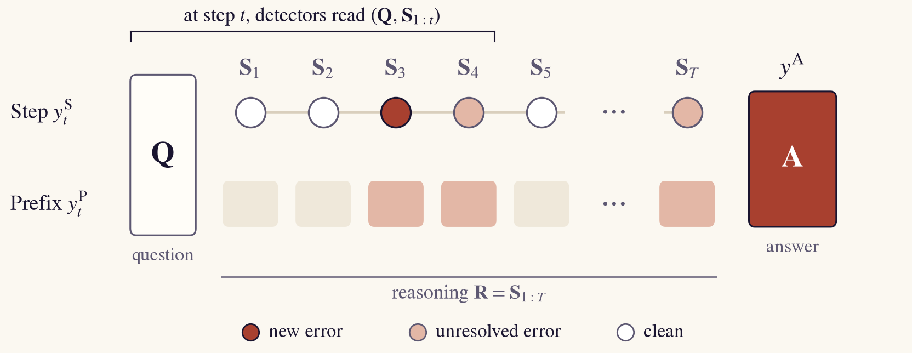
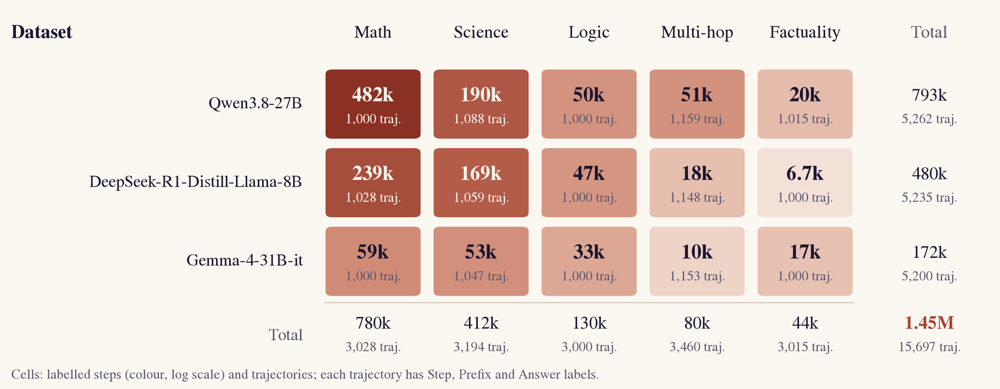
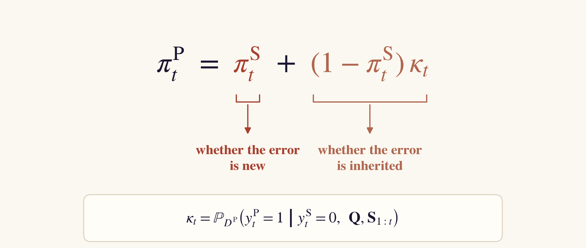
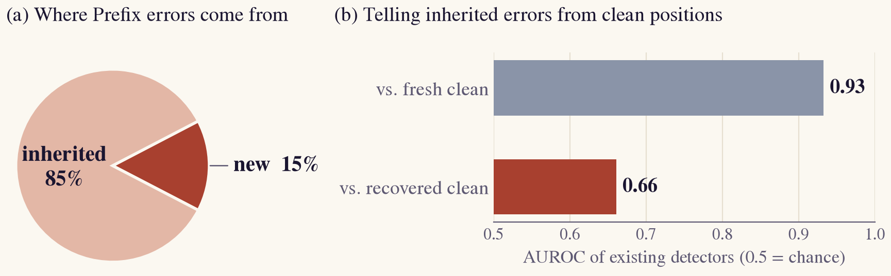
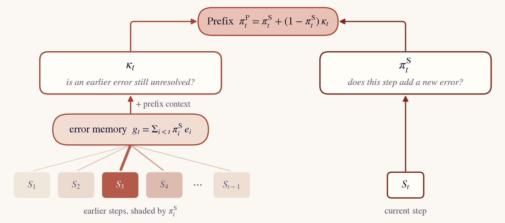
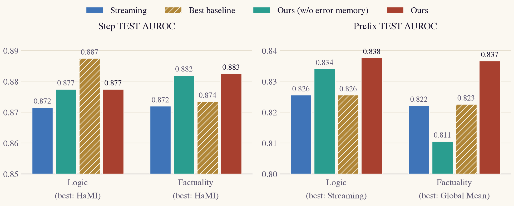
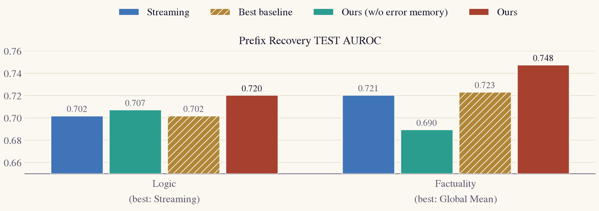

# Errors Are Introduced, Then Carried

*Streaming hallucination detection as one chain from Step to Prefix to Answer.*

<!-- kicker: The **task** -->
## §1 Background



While the model reasons, each detector reads what has been generated so far and outputs the probability that its label is 1:

```math
\begin{aligned}
\pi^{\mathrm{S}}_t&=\mathbb{P}_{D^{\mathrm{S}}}(y^{\mathrm{S}}_t=1\mid \mathbf{Q},\mathbf{S}_{1:t}), &&\text{Step}\\
\pi^{\mathrm{P}}_t&=\mathbb{P}_{D^{\mathrm{P}}}(y^{\mathrm{P}}_t=1\mid \mathbf{Q},\mathbf{S}_{1:t}), &&\text{Prefix}\\
\pi^{\mathrm{A}}&=\mathbb{P}_{D^{\mathrm{A}}}(y^{\mathrm{A}}=1\mid \mathbf{Q},\mathbf{R},\mathbf{A}). &&\text{Answer}
\end{aligned}
```



<!-- kicker: The **decomposition** -->
## §2 Theory



The derivation of the Prefix decomposition is given step by step in the [Appendix](#appendix-derivation-of-the-prefix-decomposition). The Answer builds on the final Prefix state, with $`\alpha_c`$ the probability of a wrong answer given final Prefix label $`c`$:

```math
\pi^{\mathrm{A}}=\pi^{\mathrm{P}}_T\,\alpha_1+(1-\pi^{\mathrm{P}}_T)\,\alpha_0 .
```

<!-- kicker: The **difficulty** -->
## §3 Challenge



**Diagnosis.** 85% of Prefix errors are inherited. Existing detectors separate them from positions before any error (0.93) far better than from positions whose earlier error was resolved (0.66).

**Challenge.** Prefix detection hinges on $`\kappa_t`$: distinguishing an inherited error that remains unresolved from one that has already been corrected, a distinction existing detectors barely capture.

<!-- kicker: The **framework** -->
## §4 Method



↳ Method details: [error-memory experiment](https://github.com/pILLOW-1/streaming_hd/blob/main/experiments/qwen_c18_error_memory_20261114/README.md).

<!-- kicker: The **numbers** -->
## §5 Preliminary result

Experiments are run on Qwen3.8-27B, in the Logic and Factuality domains.





**Finding.** The error memory helps recovery: it raises the inherited-vs-recovered AUROC from 0.707 to 0.720 on Logic and from 0.690 to 0.748 on Factuality, above every baseline.

**Limitation.** Under joint modelling, Step performance still trails the best baseline (0.877 vs 0.887 on Logic), and the framework has so far been run on only two domains.

<!-- kicker: The **derivation** -->
## Appendix: derivation of the Prefix decomposition

**Setting.** Fix a step $`t`$ and write $`\mathbf{H}_t=(\mathbf{Q},\mathbf{S}_{1:t})`$ for what the detectors have read. The step has two binary labels, $`y^{\mathrm{S}}_t`$ (the step introduces a new error) and $`y^{\mathrm{P}}_t`$ (the prefix through step $`t`$ contains an unresolved error). All probabilities below are conditional on $`\mathbf{H}_t`$.

**(C) Labelling constraint.** By the annotation manual, a step that introduces a new error leaves an unresolved error in the prefix:

```math
y^{\mathrm{S}}_t=1 \;\Longrightarrow\; y^{\mathrm{P}}_t=1 .
```

So the pair $`(y^{\mathrm{S}}_t,y^{\mathrm{P}}_t)`$ takes only the values $`(1,1)`$, $`(0,1)`$ and $`(0,0)`$; the value $`(1,0)`$ never occurs.

**(D1) Joint Prefix detector.** The Prefix detector defines a distribution $`\mathbb{P}_{D^{\mathrm{P}}}(\,\cdot\mid\mathbf{H}_t)`$ jointly over $`(y^{\mathrm{S}}_t,y^{\mathrm{P}}_t)`$ that

1. gives zero probability to the excluded pair, $`\mathbb{P}_{D^{\mathrm{P}}}(y^{\mathrm{S}}_t=1,\,y^{\mathrm{P}}_t=0\mid\mathbf{H}_t)=0`$, as required by (C);
2. takes its Step marginal from the Step detector, $`\mathbb{P}_{D^{\mathrm{P}}}(y^{\mathrm{S}}_t=1\mid\mathbf{H}_t)=\mathbb{P}_{D^{\mathrm{S}}}(y^{\mathrm{S}}_t=1\mid\mathbf{H}_t)`$.

**(D2) Quantities.**

```math
\begin{aligned}
\pi^{\mathrm{S}}_t&=\mathbb{P}_{D^{\mathrm{S}}}(y^{\mathrm{S}}_t=1\mid\mathbf{H}_t),\\
\pi^{\mathrm{P}}_t&=\mathbb{P}_{D^{\mathrm{P}}}(y^{\mathrm{P}}_t=1\mid\mathbf{H}_t),\\
\kappa_t&=\mathbb{P}_{D^{\mathrm{P}}}(y^{\mathrm{P}}_t=1\mid y^{\mathrm{S}}_t=0,\,\mathbf{H}_t)\quad\text{whenever } \pi^{\mathrm{S}}_t<1 .
\end{aligned}
```

**Derivation.** Dropping the conditioning on $`\mathbf{H}_t`$ and writing $`\mathbb{P}`$ for $`\mathbb{P}_{D^{\mathrm{P}}}`$:

```math
\begin{aligned}
\pi^{\mathrm{P}}_t
&\overset{(a)}{=} \mathbb{P}(y^{\mathrm{P}}_t=1)\\
&\overset{(b)}{=} \mathbb{P}(y^{\mathrm{P}}_t=1,\,y^{\mathrm{S}}_t=1)+\mathbb{P}(y^{\mathrm{P}}_t=1,\,y^{\mathrm{S}}_t=0)\\
&\overset{(c)}{=} \mathbb{P}(y^{\mathrm{S}}_t=1)-\mathbb{P}(y^{\mathrm{S}}_t=1,\,y^{\mathrm{P}}_t=0)+\mathbb{P}(y^{\mathrm{P}}_t=1,\,y^{\mathrm{S}}_t=0)\\
&\overset{(d)}{=} \mathbb{P}(y^{\mathrm{S}}_t=1)+\mathbb{P}(y^{\mathrm{P}}_t=1,\,y^{\mathrm{S}}_t=0)\\
&\overset{(e)}{=} \pi^{\mathrm{S}}_t+\mathbb{P}(y^{\mathrm{P}}_t=1,\,y^{\mathrm{S}}_t=0)\\
&\overset{(f)}{=} \pi^{\mathrm{S}}_t+\mathbb{P}(y^{\mathrm{S}}_t=0)\,\mathbb{P}(y^{\mathrm{P}}_t=1\mid y^{\mathrm{S}}_t=0)\\
&\overset{(g)}{=} \pi^{\mathrm{S}}_t+(1-\pi^{\mathrm{S}}_t)\,\kappa_t
\end{aligned}
```

- (a) Definition of $`\pi^{\mathrm{P}}_t`$ in (D2).
- (b) Total probability, splitting on $`y^{\mathrm{S}}_t\in\{0,1\}`$.
- (c) Total probability within $`y^{\mathrm{S}}_t=1`$: $`\mathbb{P}(y^{\mathrm{S}}_t=1)=\mathbb{P}(y^{\mathrm{S}}_t=1,y^{\mathrm{P}}_t=1)+\mathbb{P}(y^{\mathrm{S}}_t=1,y^{\mathrm{P}}_t=0)`$.
- (d) (D1.1): the pair excluded by (C) has probability $`0`$.
- (e) (D1.2) and the definition of $`\pi^{\mathrm{S}}_t`$ in (D2).
- (f) Product rule, valid because $`\mathbb{P}(y^{\mathrm{S}}_t=0)=1-\pi^{\mathrm{S}}_t>0`$.
- (g) Complement $`\mathbb{P}(y^{\mathrm{S}}_t=0)=1-\pi^{\mathrm{S}}_t`$ and the definition of $`\kappa_t`$ in (D2).

```math
\boxed{\;\pi^{\mathrm{P}}_t=\pi^{\mathrm{S}}_t+(1-\pi^{\mathrm{S}}_t)\,\kappa_t\;}
```

**Boundary case.** If $`\pi^{\mathrm{S}}_t=1`$, then $`\mathbb{P}(y^{\mathrm{P}}_t=1,\,y^{\mathrm{S}}_t=0)\le\mathbb{P}(y^{\mathrm{S}}_t=0)=0`$, so line (e) already gives $`\pi^{\mathrm{P}}_t=1`$. The identity still holds for any value assigned to the undefined $`\kappa_t`$, because its coefficient $`1-\pi^{\mathrm{S}}_t`$ is $`0`$.

**Reading the two terms.** The three admissible label pairs carry the probabilities

| Event | Labels | Probability |
|---|---|---|
| New error at step $`t`$ | $`y^{\mathrm{S}}_t=1,\ y^{\mathrm{P}}_t=1`$ | $`\pi^{\mathrm{S}}_t`$ |
| No new error, an earlier error is still unresolved (inherited) | $`y^{\mathrm{S}}_t=0,\ y^{\mathrm{P}}_t=1`$ | $`(1-\pi^{\mathrm{S}}_t)\,\kappa_t`$ |
| Clean | $`y^{\mathrm{S}}_t=0,\ y^{\mathrm{P}}_t=0`$ | $`(1-\pi^{\mathrm{S}}_t)(1-\kappa_t)`$ |

They sum to $`1`$, and $`\pi^{\mathrm{P}}_t`$ is the sum of the first two rows. This is also the parameterization trained in §4: the three-class loss is the negative log-likelihood of these three probabilities.

**Consequences.** Since $`0\le\kappa_t\le1`$, the identity implies $`\pi^{\mathrm{S}}_t\le\pi^{\mathrm{P}}_t\le1`$, and whenever $`\pi^{\mathrm{S}}_t<1`$ it can be inverted as $`\kappa_t=(\pi^{\mathrm{P}}_t-\pi^{\mathrm{S}}_t)/(1-\pi^{\mathrm{S}}_t)`$.

**Scope.** The identity holds for any detector satisfying (D1). It is not a property of two independently trained detectors: a stand-alone Step detector and a stand-alone Prefix detector need not satisfy it, and may even give $`\pi^{\mathrm{P}}_t<\pi^{\mathrm{S}}_t`$. A detector built as in §4, which outputs $`\pi^{\mathrm{S}}_t`$ and $`\kappa_t`$ and composes them, satisfies (D1) by construction.

<!-- kicker: The **plan** -->
## §6 To do

- Building on the current framework, explore:

    1. different read-outs for the Step and Prefix inputs (e.g. last token);
    2. κ designs, including how κ is supervised and what the error memory stores;
    3. Ana's GRU memory design.

- Run the current framework on the other domains (Science, Math, Multi-hop).
