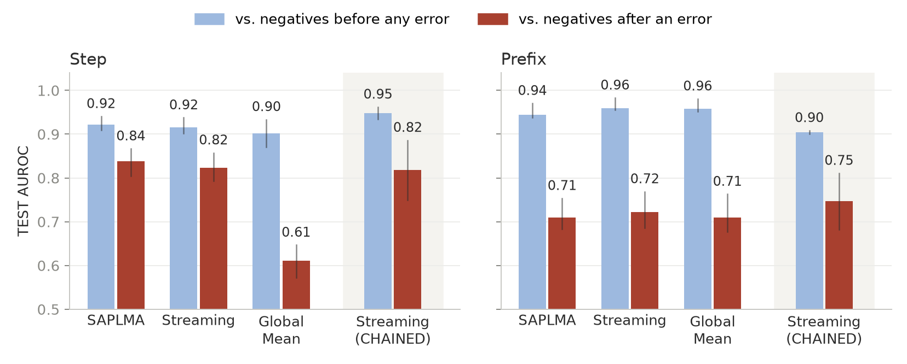
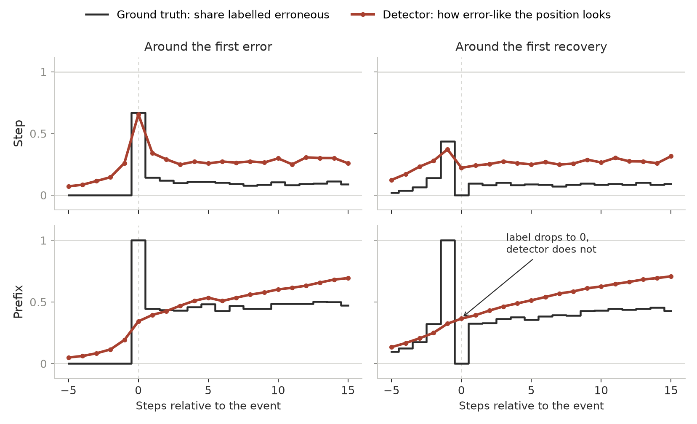

# Before and After the First Error

*Diagnosing Step and Prefix detection by error history.*

<!-- kicker: The **diagnosis** -->
## §1 Diagnosis

Every Step or Prefix positive occurs at or after the first error. We therefore split the negatives of each level by their history: *before any error* (no earlier Prefix = 1 in the trajectory) and *after an error* (some earlier Prefix = 1). Each level's AUROC then decomposes exactly:

```math
\mathrm{AUROC}=(1-r)\,A_{\mathrm{pre}}+r\,A_{\mathrm{post}},
```

where $`r`$ is the share of negatives after an error, and $`A_{\mathrm{pre}}`$, $`A_{\mathrm{post}}`$ rank all positives against each negative group. The split uses only the Prefix history, so it applies to any dataset with both labels, whatever its Step definition.

**Our dataset.** Random 6:2:2 split, TEST. We report baselines that are complete for both Step and Prefix in all 15 combinations; currently this is Streaming.



| Model | Domain | Step $`A_{\mathrm{pre}}`$ | Step $`A_{\mathrm{post}}`$ | Prefix $`A_{\mathrm{pre}}`$ | Prefix $`A_{\mathrm{post}}`$ |
|---|---|---:|---:|---:|---:|
| DS-L8 | Math | 0.9514 | 0.8462 | 0.9896 | 0.8065 |
|  | Science | 0.9149 | 0.8454 | 0.9840 | 0.7648 |
|  | Logic | 0.9568 | 0.8689 | 0.9563 | 0.7686 |
|  | Multi-hop | 0.8974 | 0.8281 | 0.9499 | 0.7189 |
|  | Fact | 0.8485 | 0.9002 | 0.8306 | 0.6951 |
| Gemma-4-31B-it | Math | 0.9431 | 0.7796 | 0.9821 | 0.7143 |
|  | Science | 0.8720 | 0.7289 | 0.9653 | 0.6639 |
|  | Logic | 0.9228 | 0.7320 | 0.9548 | 0.5928 |
|  | Multi-hop | 0.9073 | 0.8110 | 0.9575 | 0.6554 |
|  | Fact | 0.8728 | 0.8335 | 0.9593 | 0.7702 |
| Qwen3.8-27B | Math | 0.9064 | 0.7839 | 0.9848 | 0.7690 |
|  | Science | 0.9084 | 0.8094 | 0.9726 | 0.7185 |
|  | Logic | 0.9302 | 0.8017 | 0.9726 | 0.6765 |
|  | Multi-hop | 0.9679 | 0.9191 | 0.9838 | 0.7944 |
|  | Fact | 0.9323 | 0.8695 | 0.9521 | 0.7261 |

Means over combinations:

| Model | Step $`A_{\mathrm{pre}}`$ | Step $`A_{\mathrm{post}}`$ | Prefix $`A_{\mathrm{pre}}`$ | Prefix $`A_{\mathrm{post}}`$ |
|---|---:|---:|---:|---:|
| DS-L8 | 0.9138 | 0.8577 | 0.9421 | 0.7508 |
| Gemma-4-31B-it | 0.9036 | 0.7770 | 0.9638 | 0.6793 |
| Qwen3.8-27B | 0.9290 | 0.8367 | 0.9732 | 0.7369 |

| Domain | Step $`A_{\mathrm{pre}}`$ | Step $`A_{\mathrm{post}}`$ | Prefix $`A_{\mathrm{pre}}`$ | Prefix $`A_{\mathrm{post}}`$ |
|---|---:|---:|---:|---:|
| Math | 0.9336 | 0.8032 | 0.9855 | 0.7633 |
| Science | 0.8984 | 0.7946 | 0.9740 | 0.7158 |
| Logic | 0.9366 | 0.8009 | 0.9612 | 0.6793 |
| Multi-hop | 0.9242 | 0.8527 | 0.9637 | 0.7229 |
| Fact | 0.8845 | 0.8678 | 0.9140 | 0.7305 |

| Scope | Step $`A_{\mathrm{pre}}`$ | Step $`A_{\mathrm{post}}`$ | Prefix $`A_{\mathrm{pre}}`$ | Prefix $`A_{\mathrm{post}}`$ |
|---|---:|---:|---:|---:|
| All 15 combinations | **0.9155** | **0.8238** | **0.9597** | **0.7223** |

**Score dynamics.** Aligning trajectories at the first error and at the first recovery shows what the detector reacts to.



**CHAINED** ([Streaming paper data](https://huggingface.co/datasets/JlinZ/CHAINED)): independent generators, annotator and Step definition.

| Backbone | Level | $`A_{\mathrm{pre}}`$ | $`A_{\mathrm{post}}`$ |
|---|---|---:|---:|
| Qwen2.5-7B-Instruct | Prefix | 0.9010 | 0.6824 |
|  | Step | 0.9337 | 0.7495 |
| DeepSeek† | Prefix | 0.9085 | 0.8108 |
|  | Step | 0.9621 | 0.8862 |
