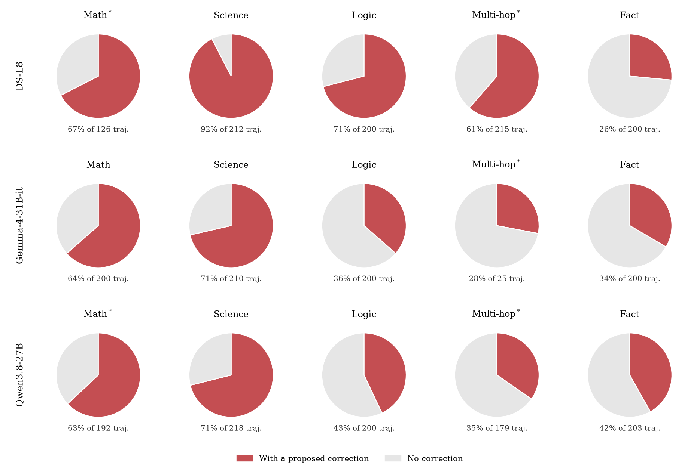
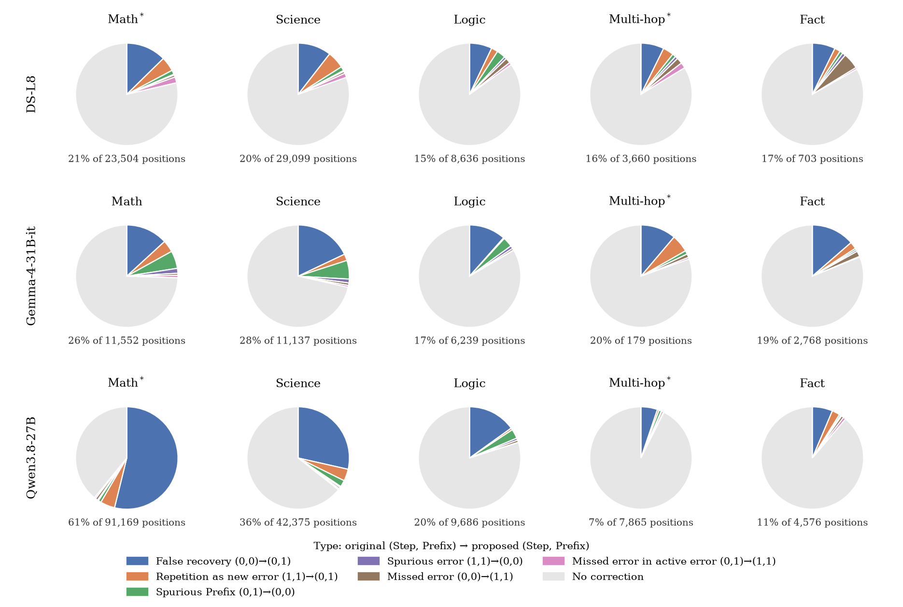

# Where the Labels Go Wrong

*Typical Step and Prefix annotation errors across the 15 model–domain combinations.*

<!-- kicker: The **distribution** -->
## §1 Error distribution

We checked the TEST labels trajectory by trajectory against the annotation manual and proposed corrected Step and Prefix labels; the original labels are unchanged. So far 2,780 of 3,142 TEST trajectories are reviewed, and 1,541 of them (55%) carry at least one proposed correction. Each correction is typed by its original and proposed (Step, Prefix) pair.

- **Most trajectories are affected, a smaller share of positions.** In 13 combinations at least a third of the reviewed trajectories carry a correction, up to 92% in DS-L8 Science. At the position level, corrections touch 7–36% of the labels, and 61% in Qwen Math.
- **False recovery is the largest type in every combination.** An error is never corrected, yet the Prefix label returns to 0. Because the Prefix should then stay 1 until the end, one such case corrects many positions, which is why the long Math and Science trajectories have the most corrected positions.
- **Two smaller types follow.** *Repetition as new error* — a step that repeats or uses an inherited error is labelled as introducing a new one — is second in 8 combinations, mostly DS-L8 and Math and Science. *Spurious Prefix* — Prefix = 1 with no unresolved error — is second in 6, including all three Logic combinations. In DS-L8 Fact the second type is a missed new error.
- **All three trace back to how the labels were made.** Each step was judged independently, without the earlier labels, so the annotation does not keep track of which errors are still unresolved.

<!-- kicker: The **examples** -->
## §2 Typical errors

For each of the three largest types, one problem fragment from TEST. Each step is a card with its text and its labels (Step, Prefix), original → corrected; the content that decides the label is in bold. A long gap between steps is shown as ⋮. Below the fragment: what the original annotation got wrong, and the error type.

<!-- Card template (one per step):
> **Step t** · original (Y, C) → corrected (Y, C)\
> step text, with the **decisive content** in bold
-->

### False recovery

*Qwen3.8-27B, Logic.* Five birds sit in a row; the robin is second from the left and the crow second from the right. The trajectory places the owl at position 1 and then checks the options.

> **Step 29** · original (1, 1) → corrected (1, 1)\
> (A) The owl is the second from the right - No, **owl is at position 1 (second from the left)**

> **Step 30** · original (0, 1) → corrected (0, 1)\
> (B) The hummingbird is the second from the right - No, hummingbird is at position 5 (the rightmost)

> **Step 31** · original **(0, 0)** → corrected **(0, 1)**\
> (C) The crow is the second from the right - Yes!

⋮

> **Step 34** · original (0, 1) → corrected (0, 1)\
> (E) The robin is the second from the right - No, robin is at position 2

> **Step 35** · original **(0, 0)** → corrected **(0, 1)**\
> The answer is (C).

**What is wrong.** Position 1 is the leftmost, not second from the left, and no later step corrects this. The original Prefix still drops to 0 at steps 31–33 and 35, and flickers back to 1 at step 34.

**Error type.** False recovery: an error that is merely no longer mentioned is still unresolved, so Prefix = 1 to the end.

### Repetition as new error

*Qwen3.8-27B, Fact.* Question: “What tastes so good that cats ask for it by name?” Cats cannot ask for anything by name; the line is an advertising slogan.

> **Step 2** · original (1, 1) → corrected (1, 1)\
> **The answer is "Tuna"** - as in the phrase "cats ask for tuna by name."

> **Step 3** · original (0, 1) → corrected (0, 1)\
> This is a common wordplay/riddle.

> **Step 4** · original **(1, 1)** → corrected **(0, 1)**\
> **Tuna** is a fish that cats are known to love, and the riddle plays on the idea that cats "ask for it by name" because they're associated with tuna fish.

**What is wrong.** Step 4 restates the answer committed at step 2 and adds only a true fact (cats like tuna); it introduces no new error.

**Error type.** Repetition as new error: repeating an inherited error is Step = 0, while the Prefix stays 1.

### Spurious Prefix

*Qwen3.8-27B, Logic.* Is “Kaia does not pray for rain” true, false or uncertain? The trajectory lists the facts about Kaia, all of them stated in the context, and deduces from them correctly.

> **Step 20** · original (0, 0) → corrected (0, 0)\
> - So Kaia does not learn ancestral songs AND Kaia does not appreciate their heritage.

> **Step 21** · original **(0, 1)** → corrected **(0, 0)**\
> From (7): If Kaia either respects her ancestors or honors her family (but not both), then she values her culture.

> **Step 22** · original (0, 0) → corrected (0, 0)\
> - Kaia honors her family (2). We don't know if she respects her ancestors.

⋮

> **Step 31** · original **(0, 1)** → corrected **(0, 0)**\
> There's no information given about whether Kaia prays for rain or not.

> **Step 32** · original (0, 0) → corrected (0, 0)\
> Since there's no information ... the statement "Kaia does not pray for rain" is uncertain.

**What is wrong.** No step introduces an error, yet the Prefix is 1 at steps 21, 25 and 31, each time for one step only. Step 21 quotes a rule from the context and step 31 states a correct observation.

**Error type.** Spurious Prefix: Prefix = 1 requires an unresolved error, and there is none.

<!-- kicker: The **plan** -->
## §3 To do

1. **Clean the dataset within one week.** Correct the Step and Prefix labels of the affected combinations, starting with the dominant error types.
2. **Meanwhile, explore methods on the less affected combinations.** Develop and compare methods where label errors change the results least, so that progress does not wait for the cleaned data.
